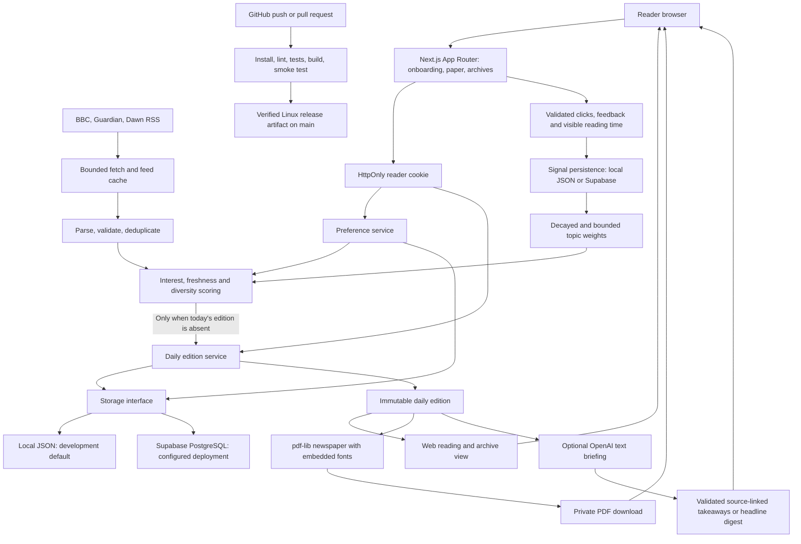
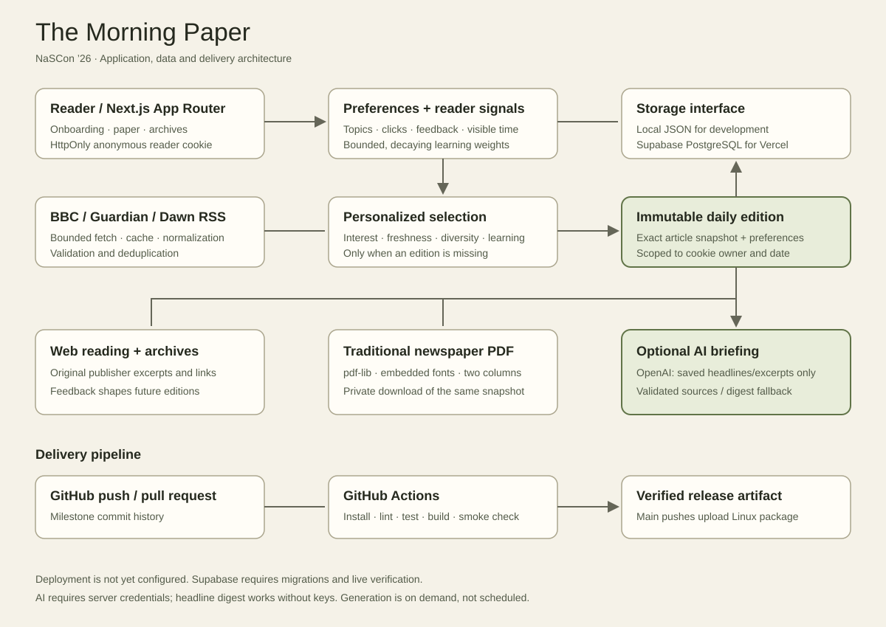

# Personal Morning Paper architecture

This diagram describes the implemented application. GitHub renders the Mermaid
diagram directly. The `.mmd` source beside this document can be imported into a
Mermaid-compatible editor for SVG/PDF export when preparing the submission.

## Request and data flow

1. Onboarding validates interests, reading budget, and timezone, saves a profile,
   and sets a random reader ID in an HttpOnly cookie.
2. `/paper` derives the local date and looks for an existing edition. A saved
   edition returns immediately, without fetching feeds or recalculating learning.
3. For a new edition, the server reads learned weights and aggregates fixed RSS
   sources. Parsing drops invalid links/dates and merges duplicates. Ranking uses
   selected interests, freshness, learned weights, and publisher variety.
4. The first complete edition saved for `(reader, date)` wins. Local storage uses
   atomic hard-link publication; PostgreSQL uses a composite key and conflict-ignore.
5. Web and PDF views read that snapshot. PDF requests never rerank or fetch feeds.
6. Signals must refer to an article in that reader's saved edition. Server-assigned
   topics and timestamps update replaceable signal records. Changes influence only
   new editions and recommendation previews.

## Boundaries and persistence

| Concern | Implementation |
| --- | --- |
| Browser UI | React components, accessible forms, download and feedback controls |
| Server | Next.js Node runtime route handlers and server components |
| Identity | Anonymous browser cookie; no account login or cross-device recovery |
| Profiles and editions | Shared `Storage` interface; JSON and Supabase adapters |
| Reader signals | Separate signal store using the same driver configuration |
| PDF | In-memory rendering; bundled Noto Serif Latin fonts; no Chromium |
| Feed cache | Per-process memory; disposable and independent of saved editions |
| Vercel | Supabase required; local storage explicitly rejected |

The browser cannot access the Supabase service-role key. Database tables enable
RLS without public policies; server-side requests scope records to the cookie owner.
This is not Supabase Auth: possession of the reader cookie is the identity boundary.

## Optional briefing

Saved snapshots feed a cookie-scoped POST briefing route. It sends only headlines
and excerpts to OpenAI and validates structured takeaways against the original
article indexes. Missing credentials/provider failures show a labeled digest.
The cache is disposable per-instance memory; snapshots are never modified.

## Delivery and current limits

CI checks pushes on all branches and PRs into main. Successful main pushes upload
a release archive. Automatic hosting deployment is not configured. Supabase code
has mocked transport tests; applying both migrations and verifying a real project
are deployment prerequisites.

The recommendation engine is transparent, rule-based adaptive scoring, not an LLM.
Optional AI text briefings use saved headlines/excerpts; audio is not implemented. Daily generation happens on first visit,
not by scheduled delivery. News availability depends on external feeds, and a new
empty edition is not saved. Saved papers remain available during feed outages.

Related: [storage](storage.md), [PDF](pdf.md), [learning](learning.md), [CI](ci.md),
[demo and submission](demo.md).
